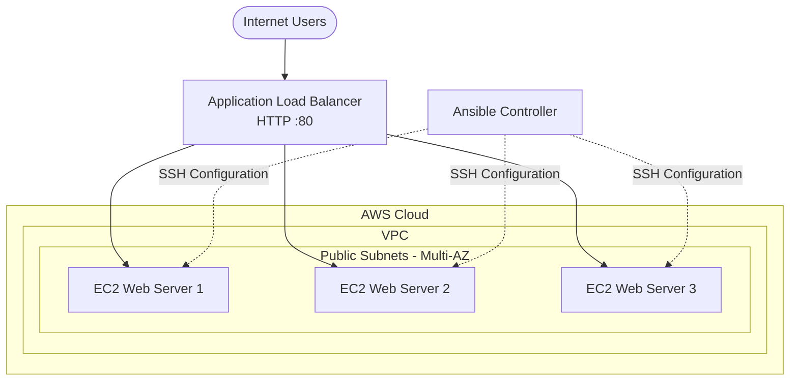

# Dahab Web Infrastructure

**Infrastructure as Code | Configuration Management | AWS**

An AWS infrastructure project demonstrating how to provision and configure a web-tier environment using **Terraform** and **Ansible**.

Terraform provisions the AWS infrastructure, while Ansible automates server configuration and application deployment. An AWS Application Load Balancer distributes incoming HTTP traffic across three EC2 web servers.

---

## Architecture



## Infrastructure Components

| Component | Responsibility |
|---|---|
| AWS VPC | Isolated network environment |
| Public Subnets | Host the web servers and ALB |
| Internet Gateway | Internet connectivity |
| Security Groups | Control network traffic |
| Amazon EC2 | Host the web application |
| Application Load Balancer | Distribute incoming HTTP requests |
| Terraform | Provision and manage infrastructure |
| Ansible | Configure instances and deploy the application |
| Nginx | Serve the deployed web page |

---

## Key Features

- **Infrastructure as Code:** Provision AWS resources using reusable Terraform modules.
- **Modular Architecture:** Separate networking, compute, and load-balancing resources into dedicated modules.
- **Configuration Management:** Automate Nginx installation and server configuration using Ansible.
- **Dynamic Inventory:** Automatically discover EC2 instances using AWS EC2 dynamic inventory and resource tags.
- **Application Deployment:** Deploy a Jinja2-templated HTML page to all web servers.
- **Load Balancing:** Distribute HTTP requests across three EC2 instances.
- **Infrastructure Lifecycle:** Manage infrastructure using Terraform's plan, apply, and destroy workflow.

---

## Technology Stack

| Category | Technologies |
|---|---|
| Cloud Provider | AWS |
| Infrastructure as Code | Terraform |
| Configuration Management | Ansible |
| Compute | Amazon EC2 |
| Networking | VPC, Subnets, Internet Gateway |
| Load Balancing | Application Load Balancer |
| Web Server | Nginx |
| Automation | Ansible Playbooks, Jinja2 |
| Inventory | Ansible AWS EC2 Dynamic Inventory |

---

## Repository Structure

```text
Tf-Ansible-pipeline/
│
├── terraform/
│   ├── main.tf
│   ├── variables.tf
│   ├── outputs.tf
│   ├── providers.tf
│   │
│   └── modules/
│       ├── network/
│       ├── compute/
│       └── alb/
│
├── ansible/
│   ├── ansible.cfg
│   ├── aws_ec2.yaml
│   ├── playbook.yaml
│   └── roles/
│       ├── app/
│       │   └── templates/
│       │       └── index.html.j2
│       └── ...
│
├── app-demo.sh
├── .gitignore
└── README.md
```

---

## Deployment Workflow

The deployment process consists of two main stages.

### Stage 1: Infrastructure Provisioning

Terraform provisions the required AWS infrastructure.

1. Initialize the Terraform working directory.
2. Validate the Terraform configuration.
3. Generate and review an execution plan.
4. Apply the configuration to provision AWS resources.

### Stage 2: Configuration Management & Application Deployment

Ansible takes over after infrastructure provisioning.

1. Discover running EC2 instances through AWS dynamic inventory.
2. Identify target instances using the `Role=WebServer` tag.
3. Connect to the instances over SSH.
4. Install required packages and Nginx.
5. Deploy the application using a Jinja2 template.

---

## Prerequisites

Before deploying the project, ensure you have:

- An AWS account.
- AWS CLI installed and configured.
- Terraform >= 1.5.0.
- Python 3.
- Ansible.
- An existing EC2 key pair in the selected AWS region.
- The corresponding private key available locally.

The AWS identity must have sufficient permissions to provision and manage the required networking, EC2, and load-balancing resources. It also needs permission to describe EC2 instances for dynamic inventory discovery.

---

## Getting Started

### 1. Configure AWS Credentials

Configure your AWS credentials:

```bash
aws configure
```

Verify your AWS identity:

```bash
aws sts get-caller-identity
```

### 2. Provision Infrastructure with Terraform

Navigate to the Terraform directory:

```bash
cd terraform
```

Initialize Terraform:

```bash
terraform init
```

Format and validate the configuration:

```bash
terraform fmt -check -recursive
terraform validate
```

Generate an execution plan:

```bash
terraform plan \
  -var="key_name=YOUR_EXISTING_KEY_PAIR_NAME" \
  -var="ssh_cidr=YOUR_PUBLIC_IP/32" \
  -out=tfplan
```

Review the plan, then provision the infrastructure:

```bash
terraform apply tfplan
```

The default AWS region is `us-east-1`.

If you change the region, ensure the Ansible dynamic inventory configuration in `ansible/aws_ec2.yaml` uses the same region.

Retrieve infrastructure outputs:

```bash
terraform output
```

### 3. Install Ansible Dependencies

From the repository root:

```bash
python3 -m pip install ansible boto3 botocore
```

Install the AWS collection:

```bash
ansible-galaxy collection install amazon.aws
```

### 4. Configure Ansible

Review:

```text
ansible/ansible.cfg
```

Update the following settings:

- `private_key_file`: Path to your local EC2 private key.
- Any machine-specific absolute paths.
- SSH host-key checking settings.

Never commit private keys or AWS credentials to the repository.

### 5. Execute the Ansible Playbook

Run the playbook from the repository root:

```bash
ANSIBLE_CONFIG=ansible/ansible.cfg \
ansible-playbook \
  -i ansible/aws_ec2.yaml \
  ansible/playbook.yaml
```

Ansible automatically discovers running instances tagged with:

```text
Role=WebServer
```

It then configures the instances and deploys the web page.

### 6. Verify the Deployment

Retrieve the ALB URL:

```bash
cd terraform
terraform output -raw alb_url
```

Open the resulting URL in your browser.

The Application Load Balancer distributes incoming HTTP requests across the registered EC2 instances.

---

## Security Considerations

This project is intended for learning and demonstration purposes, not production deployment.

Important considerations:

- EC2 instances currently reside in public subnets and receive public IP addresses.
- Restrict SSH access to your own trusted public IP address using the `ssh_cidr` variable.
- Never expose SSH access to `0.0.0.0/0`.
- The Application Load Balancer currently uses HTTP rather than HTTPS.
- Store AWS credentials and EC2 private keys securely.
- Do not commit Terraform state files, execution plans, credentials, or private keys.
- Review IAM permissions and follow the principle of least privilege.

---

## Cost Considerations

This project provisions billable AWS resources, including:

- EC2 instances.
- Application Load Balancer.
- Associated networking resources.

AWS charges may apply even when the application is not actively receiving traffic.

**Always destroy the infrastructure when you finish experimenting.**

---

## Cleanup

To remove the provisioned AWS infrastructure:

```bash
cd terraform

terraform destroy \
  -var="key_name=YOUR_EXISTING_KEY_PAIR_NAME" \
  -var="ssh_cidr=YOUR_PUBLIC_IP/32"
```

Review the destruction plan before confirming.

Note: The existing EC2 key pair is a prerequisite and is not managed by this Terraform project.

---

## Future Improvements

Potential enhancements to evolve this project toward a more production-oriented architecture:

- [ ] Implement GitHub Actions for automated Terraform validation and deployment.
- [ ] Introduce Terraform remote state management using Amazon S3.
- [ ] Move EC2 instances into private subnets.
- [ ] Replace direct SSH access with AWS Systems Manager Session Manager.
- [ ] Implement an Auto Scaling Group and Launch Template.
- [ ] Configure HTTPS using AWS Certificate Manager.
- [ ] Introduce CloudWatch monitoring, metrics, and alarms.
- [ ] Add automated deployment verification and health checks.
- [ ] Integrate infrastructure security scanning.

---

## Learning Objectives

This project demonstrates practical experience with:

- AWS networking and compute fundamentals.
- Infrastructure provisioning using Terraform.
- Modular Infrastructure as Code design.
- Configuration management using Ansible.
- AWS EC2 dynamic inventory.
- Automated web-server configuration.
- Application Load Balancing.
- Infrastructure lifecycle management.

---

**Project:** Dahab Web Infrastructure  
**Repository:** [Tf-Ansible-pipeline](https://github.com/3deljunior/Tf-Ansible-pipeline)
